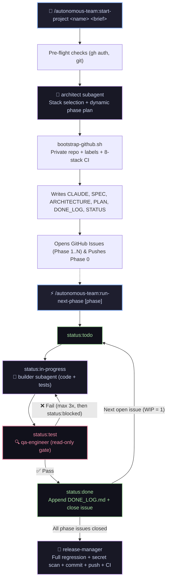

<div align="center">

# ⚡ Github & Claude Autonomous Team

**Turn a one-paragraph brief into a private GitHub repo — architected, built, QA-gated, and shipped phase by phase.**

[](https://docs.anthropic.com/en/docs/claude-code)
[](#universal-ci)
[](#guardrails)
[](LICENSE)

[Why This Exists](#why-this-exists) • [Workflow](#workflow-overview) • [Quick Start](#quick-start) • [Walkthrough](#end-to-end-walkthrough) • [Universal CI](#universal-ci) • [Guardrails](#guardrails)

---

</div>

`autonomous-team` is a **stack-agnostic Claude Code plugin** that transforms a short project brief into a production-grade engineering workflow. Instead of hardcoding one language or a rigid template, it selects the optimal stack per surface (**backend, web, mobile, CLI, worker**), scales the phase count to your actual scope, and executes with **GitHub Issues**, a **read-only QA gate**, **persistent engineering logs**, and **multi-language CI**.

---

<a id="why-this-exists"></a>
## 🧠 Why This Exists

Long autonomous coding sessions almost always fail in four predictable ways. `autonomous-team` replaces hope with mechanical guardrails:

| 💥 The Failure Mode | 🛡️ The Mechanical Guardrail |
| :--- | :--- |
| **Context Drift** — Decisions vanish across sessions or after compaction. | Every closed issue appends a structured entry to `DONE_LOG.md` & the GitHub Issue, while `STATUS.md` tracks live state. |
| **Premature Completion** — Tasks close without tests, or tests get silently skipped. | A **read-only `qa-engineer`** (`Write`/`Edit` disabled) runs lint, build, and tests, and rejects diffs containing skip/ignore patterns. |
| **Contract Mismatches** — Frontend, mobile, and backend drift apart. | Multi-surface projects lock shared schemas and contracts in **Phase 1** before feature code begins. |
| **Messy Git History** — One massive, unverified dump of changes. | Strict **`WIP = 1`** issue flow. Each finished phase runs full regression, commits with Conventional Commits, and pushes to `origin main`. |

---

<a id="workflow-overview"></a>
## 🔄 Workflow Overview



---

<a id="quick-start"></a>
## ⚙️ Quick Start

### Prerequisites
- **[Claude Code](https://docs.anthropic.com/en/docs/claude-code)** CLI
- **`git`**
- **[GitHub CLI (`gh`)](https://cli.github.com/)** authenticated with `repo` write permissions:
  ```bash
  gh auth login && gh auth status
  ```

### Option 1: Load Directly From a Local Folder

```bash
chmod +x claude-autonomous-team/scripts/bootstrap-github.sh

# Validate the plugin manifest strictly before loading
claude plugin validate --strict ./claude-autonomous-team

# Launch Claude Code with the plugin active
claude --plugin-dir ./claude-autonomous-team
```

### Option 2: Publish to Your Own GitHub Repository

```bash
cd claude-autonomous-team
chmod +x scripts/bootstrap-github.sh
git init -b main && git add -A
git commit -m "feat: initial autonomous-team plugin"
gh repo create claude-autonomous-team --private --source=. --remote=origin --push
```

> [!NOTE]
> **Command Namespacing:** The manifest sets `"name": "autonomous-team"` so `claude plugin validate --strict` passes Anthropic's reserved `claude-` prefix check. All commands are invoked under that namespace: `/autonomous-team:start-project` and `/autonomous-team:run-next-phase`.

---

<a id="end-to-end-walkthrough"></a>
## 🚀 End-to-End Walkthrough

### 1. Bootstrap a New Project (Phase 0)

Start Claude Code from the parent directory where you want your new repository created:

```bash
claude --plugin-dir /path/to/claude-autonomous-team
```

Run inside Claude Code:

```text
/autonomous-team:start-project invoice-portal Multi-tenant invoicing web app with item-based billing, PDF export, and role-based approval limits. Use .NET 9 for the API and React + TypeScript for the frontend.
```

**What happens automatically:**
- Creates a **private** GitHub repo `invoice-portal` under your `gh` account.
- Provisions `status:*`, `surface:*`, and `phase:0..N` labels.
- Opens GitHub Issues for every task across Phases `1..N` with acceptance criteria and test requirements, linking issue numbers back into `PLAN.md`.
- Scaffolds the repo and pushes **Phase 0** to `origin main`:

```text
invoice-portal/
├── .github/workflows/ci.yml   # 8-stack auto-detecting CI
├── .gitignore
├── ARCHITECTURE.md            # Stack decisions & shared contracts
├── CLAUDE.md                  # Core operating rules
├── DONE_LOG.md                # Append-only engineering log
├── PLAN.md                    # Dynamic phases linked to GitHub Issues
├── SPEC.md                    # Product specification
└── STATUS.md                  # Live execution state
```

### 2. Execute Phases One by One

```bash
cd invoice-portal
claude --plugin-dir /path/to/claude-autonomous-team
```

Run the next pending phase (or target a specific phase like `/autonomous-team:run-next-phase 2`):

```text
/autonomous-team:run-next-phase
```

Every state transition prints a live single-line telemetry banner in your terminal and syncs `STATUS.md`:

```text
[PHASE 1/5 | ISSUE #1 | ROLE: builder     | STATE: status:in-progress | TESTS: pending]
[PHASE 1/5 | ISSUE #1 | ROLE: qa-engineer | STATE: status:test        | TESTS: running]
[PHASE 1/5 | ISSUE #1 | ROLE: qa-engineer | STATE: status:done        | TESTS: 18/18 PASS]
```

Once all issues in the phase close, `release-manager` runs a full multi-surface regression, scans for leaked secrets or stray files, commits (`feat(phase-1): ...`), pushes to `origin main`, and verifies GitHub Actions. Repeat until every phase is `COMPLETED`.

---

<a id="universal-ci"></a>
## 🌐 Supported Stacks & Universal CI

The bundled `.github/workflows/ci.yml` inspects your repo up to **3 levels deep** and triggers CI jobs *only* for stacks actually present. Polyglot monorepos run detected stacks in parallel.

| Ecosystem | Detection Signal | Checks Executed | Monorepo Support |
| :--- | :--- | :--- | :--- |
| **Node / TypeScript** | `package.json` | `lint`, `typecheck`, `build`, `test` (`pnpm`/`yarn`/`npm`) | Root workspaces & multi-package |
| **Python** | `pyproject.toml`, `requirements.txt` | `ruff check .`, `pytest` | Per-directory isolated temp venvs |
| **Go** | `go.mod` | `gofmt -l`, `go vet ./...`, `go build ./...`, `go test -race ./...` | Per-module loop |
| **Rust** | `Cargo.toml` | `cargo fmt --check`, `cargo clippy -D warnings`, `cargo test --all` | Workspaces & independent crates |
| **Flutter / Dart** | `pubspec.yaml` | `flutter analyze && flutter test` (or `dart` for pure Dart) | Per-package loop |
| **Swift** | `Package.swift` | `swift build && swift test` | Per-package loop (`ubuntu-latest`*) |
| **.NET / C#** | `*.sln`, `*.slnx`, `*.csproj` | `dotnet restore`, `build`, `test` | Solution-first, project fallback |
| **Gradle / Kotlin / Java** | `build.gradle`, `build.gradle.kts` | `./gradlew check` (or `gradle check` fallback) | Per-project loop |

> [!TIP]
> **Swift & Phase 0:** Swift targets run on `ubuntu-latest` by default; switch `swift-ci` to `macos-latest` for UIKit/SwiftUI apps. On **Phase 0** (docs + CI only), `detect-stacks` returns `false` across the board so the workflow passes green with zero false failures.

---

<a id="guardrails"></a>
## 🛡️ Guardrails & Failure Handling

- **🔒 Read-Only QA Gate:** `agents/qa-engineer.md` sets `disallowedTools: Write, Edit`. It physically cannot weaken tests or patch code to force a green build.
- **🚫 Zero-Bypass Diff Audit:** Diffs containing `.skip(`, `xit(`, `#[ignore]`, `@pytest.mark.skip`, `// nolint`, `# noqa`, `@ts-ignore`, or `eslint-disable` fail QA immediately.
- **⚡ Blocker Circuit Breaker:** If an issue fails QA **3 consecutive times** for the same root cause, execution halts, applies `status:blocked`, logs all 3 attempts on the GitHub Issue and `STATUS.md`, and hands control back to you.
- **♻️ Crash-Proof Recovery:** Because state lives in GitHub Issues, `STATUS.md`, and `DONE_LOG.md`, running `/autonomous-team:run-next-phase` in a brand-new session automatically resumes the active `status:in-progress` or `status:test` issue without duplicating work.

---

<details>
<summary><b>📂 Repository Structure</b></summary>

```text
claude-autonomous-team/
├── .claude-plugin/
│   └── plugin.json              # Plugin manifest (auto-discovers commands/ and agents/)
├── agents/
│   ├── architect.md             # Stack selection, contracts, dynamic phase planning
│   ├── builder.md               # Production code + unit/integration tests
│   ├── qa-engineer.md           # Read-only quality gate (Write/Edit disallowed)
│   └── release-manager.md       # Multi-surface regression, hygiene, commit/push, CI check
├── commands/
│   ├── start-project.md         # /autonomous-team:start-project
│   └── run-next-phase.md        # /autonomous-team:run-next-phase
├── scripts/
│   └── bootstrap-github.sh      # Private repo creation + label provisioning
├── templates/
│   ├── ARCHITECTURE.template.md
│   ├── DONE_LOG.template.md
│   ├── PLAN.template.md
│   ├── SPEC.template.md
│   ├── STATUS.template.md
│   └── ci-universal.yml         # Auto-detecting 8-ecosystem GitHub Actions workflow
├── CLAUDE.md                    # Core operating rules copied into generated projects
├── LICENSE                      # MIT
└── README.md
```

</details>

<details>
<summary><b>🎛️ Customization</b></summary>

- **Tune subagent models or budgets:** Edit `model` and `maxTurns` in `agents/*.md` frontmatter (e.g., bump `architect.md` from `sonnet` to `opus` for complex systems).
- **Add another CI ecosystem:** Add a detection output in `detect-stacks` and a matching job in `templates/ci-universal.yml`.
- **Change repo visibility or default branch:** Edit `scripts/bootstrap-github.sh` (`--private` → `--public`, `-b main` → your branch).

</details>

<details>
<summary><b>🔧 Troubleshooting</b></summary>

- **`gh auth status` fails during `/autonomous-team:start-project`:** Run `gh auth login` and ensure your token includes the `repo` scope.
- **Slash commands don't appear as `/start-project`:** Claude Code namespaces plugin commands by manifest `name`. Use `/autonomous-team:start-project` and `/autonomous-team:run-next-phase`.
- **`claude plugin validate` reports an error:** Run `claude plugin validate --strict ./claude-autonomous-team` to pinpoint invalid JSON keys or frontmatter syntax.
- **Resuming after manually fixing a `status:blocked` issue:** Remove the `status:blocked` label on GitHub, restore `status:todo` (or `status:in-progress`), and re-run `/autonomous-team:run-next-phase`.

</details>

---

<div align="center">

Released under the [MIT License](LICENSE).

</div>
